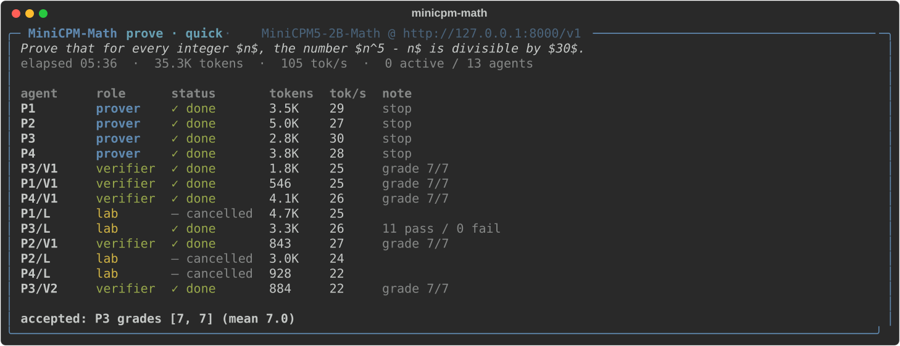
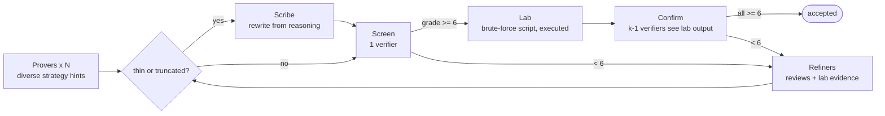

<div align="center">

# MiniCPM-Math Harness

**A proof swarm you can run yourself.**

Parallel provers, adversarial verifiers, brute-force checks and repair loops,<br/>
built around a 2.5B math model that fits on one GPU or a laptop.

[Model](https://huggingface.co/Caldalis/MiniCPM5-2B-Math) ·
[GGUF](https://huggingface.co/Caldalis/MiniCPM5-2B-Math-GGUF) ·
[How it works](docs/how-it-works.md) ·
[中文](README_zh.md)

</div>

---

This project pairs [MiniCPM5-2B-Math](https://huggingface.co/Caldalis/MiniCPM5-2B-Math), a math and proof model
based on [MiniCPM5-2B](https://huggingface.co/openbmb/MiniCPM5-2B), with a harness designed around the specific ways
this model fails when you sample it once.

**Results at a glance:** as a plain single call that may think for up to 128K tokens, MiniCPM5-2B-Math scores
**92.3 on AIME 2025, 89.8 on AIME 2026 and 81.8 on HMMT February 2026** (avg@16), and a 16-sample vote raises that to
**100 / 93.3 / 90.9**.

<p align="center">

</p>
<p align="center"><sub>A real run on an Apple M5 laptop (llama.cpp, Q8_0, 4 slots, <code>--profile quick</code>): four provers,
one screening review each, a brute-force check (11 PASS, 0 FAIL) and a confirming review. Accepted after 5½ minutes
and 35K tokens; the remaining checks were cancelled.</sub></p>

## Quickstart

**1. Serve the model** with any OpenAI-compatible server:

```bash
# NVIDIA GPU (vLLM >= 0.21); the model's native context is 131,072 tokens
vllm serve Caldalis/MiniCPM5-2B-Math --max-model-len 131072 --port 8000

# Mac / CPU (llama.cpp b9833 or newer): 4 parallel slots sharing a 96K-token KV cache; use --profile quick with it
llama-server -hf Caldalis/MiniCPM5-2B-Math-GGUF:Q8_0 --jinja -ngl 99 -c 98304 -np 4 -kvu --port 8000
```

[`scripts/`](scripts/) also covers SGLang and MLX. In LM Studio, load the GGUF, start the local server and pass
`--base-url http://127.0.0.1:1234/v1`. Older llama.cpp builds (before b9354) cannot load the GGUF, because they do not
know the MiniCPM5 tokenizer.

**2. Install the harness:**

```bash
pip install "minicpm-math[math] @ git+https://github.com/Caldalis/MiniCPM-Math-harness"   # or: git clone ... && pip install -e ".[math]"
minicpm-math check --base-url http://127.0.0.1:8000/v1      # verifies thinking, answer format and raw completions
```

**3. Run it:**

```bash
# search for a proof (problem text, a file, or "-" for stdin)
minicpm-math prove examples/problems/n5-minus-n.md

# answer a question by voting; 4 extra "coder" agents write and run Python
minicpm-math solve "Find the sum of all positive integers n such that n^2-19n+99 is a perfect square." --coders 4

# on a laptop, start small
minicpm-math prove examples/problems/nesbitt.md --profile quick
```

The final proof is printed to stdout. The full report (`final.md`), every call (`calls.jsonl`) and every executed
script (`events.jsonl`) are saved under `runs/`.

## Profiles

| profile | provers | verifiers | repair rounds | tokens / call | meant for |
|---|---:|---:|---:|---:|---|
| `quick` | 4 | 2 | 1 | 16K | laptop demo |
| `standard` | 8 | 3 | 2 | 32K | default |
| `heavy` | 16 | 4 | 3 | 64K | one 24 GB GPU |
| `swarm` | 64 | 4 | 4 | 96K | a multi-GPU node |

## How it works



- **Diversity before scale.** Identical small models tend to make the same mistake together. Each prover gets a
  different, optional strategy hint (small cases, invariants, extremal arguments, induction, inequalities,
  double counting, construction-first).
- **Screen, then check, then confirm.** One verifier screens each candidate. Only candidates that pass get the lab
  check and the remaining verifiers, so a bad candidate costs one review instead of a script plus k reviews.
- **Evidence over opinion.** Lab output (`PASS:` / `FAIL:` lines from an executed brute-force script) is shown to the
  confirming verifiers and to the refiners, so a disagreement about a formula is settled by computation.
- **Honest output.** A proof is reported as `accepted` only if every verifier gave it at least 6/7. Otherwise you get
  the best attempt, labeled `unverified`. On IMO-ProofBench Basic, 23 of the 28 accepted proofs were graded correct
  by a blind AI grader (Claude Opus 5.5), 2 almost correct and 3 not valid. That is evidence, not a guarantee. You can
  plug in a stronger checker with `--verifier-base-url/--verifier-model` (small prover, big verifier).

## Python API

```python
import asyncio
from minicpm_math import Backend, Swarm, config_for

async def main():
    backend = Backend("http://127.0.0.1:8000/v1")
    swarm = Swarm(backend, config_for("standard", provers=8))
    result = await swarm.prove("Prove that there are infinitely many primes of the form 4k+3.")
    print(result.status, result.best.grades if result.best else [])
    print(result.proof)
    await backend.aclose()

asyncio.run(main())
```

## Results

### Answers: AIME and HMMT

| Benchmark | MiniCPM5-2B<br/>avg@16 | MiniCPM5-2B-Math<br/>avg@16 | MiniCPM5-2B<br/>vote (maj@16) | MiniCPM5-2B-Math<br/>vote (maj@16) |
|---|---:|---:|---:|---:|
| AIME 2025 | 87.1 | **92.3** | 93.3 | **100.0** |
| AIME 2026 | 89.8 | 89.8 | 93.3 | 93.3 |
| HMMT Feb 2026 | 68.4 | **81.8** | 75.8 | **90.9** |

## Models

| | |
|---|---|
| [MiniCPM5-2B-Math](https://huggingface.co/Caldalis/MiniCPM5-2B-Math) | BF16 safetensors, `LlamaForCausalLM`, 128K context |
| [MiniCPM5-2B-Math-GGUF](https://huggingface.co/Caldalis/MiniCPM5-2B-Math-GGUF) | Q4_K_M (1.6 GB), Q8_0 (2.7 GB), BF16 (5.0 GB) for llama.cpp, LM Studio and Ollama |

Recommended sampling: `temperature=0.9, top_p=0.95, min_p=0` with thinking enabled. The harness sets these for you.

## License

Apache-2.0, for both the harness and the model weights. The base model,
[MiniCPM5-2B](https://huggingface.co/openbmb/MiniCPM5-2B), is released by OpenBMB under Apache-2.0.
The benchmark material in [`docs/results/`](docs/results/) keeps its own licenses: the IMO-ProofBench problem
statements are CC BY 4.0 (Copyright 2025 Google LLC) and the MathArena answers CC BY-NC-SA 4.0. See
[docs/results/README.md](docs/results/README.md).
