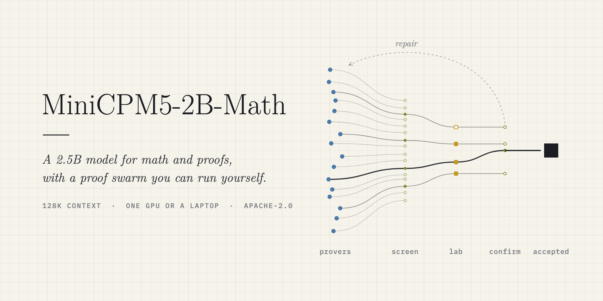
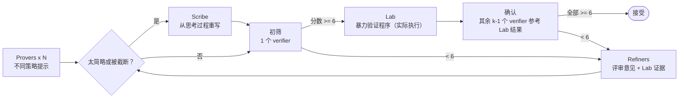

<div align="center">



<p>
  <a href="./README.md">English</a> |
  <a href="./README_zh.md">简体中文</a>
</p>

<p>
  
  <a href="https://huggingface.co/Caldalis/MiniCPM5-2B-Math"></a>
  <a href="https://huggingface.co/Caldalis/MiniCPM5-2B-Math-GGUF"></a>
  <a href="./scripts/"></a>
  <a href="https://github.com/Caldalis/MiniCPM-Math-harness/actions/workflows/tests.yml"></a>
  <a href="./LICENSE"></a>
  <a href="https://github.com/Caldalis/MiniCPM-Math-harness/graphs/commit-activity"></a>
  <a href="https://github.com/Caldalis/MiniCPM-Math-harness/issues"></a>
</p>

# MiniCPM-Math Harness

**一个你自己就能跑起来的"证明蜂群"。**

并行证明、对抗式审稿、暴力验算、迭代修补，<br/>
围绕一个 2.5B 数学模型构建，一张显卡或一台笔记本就能运行。

</div>

---

项目包含 [MiniCPM5-2B-Math](https://huggingface.co/Caldalis/MiniCPM5-2B-Math)（基于
[MiniCPM5-2B](https://huggingface.co/openbmb/MiniCPM5-2B) 后训练的数学与证明模型），以及一套专门针对它
单次采样时的失败模式设计的 harness。

**成绩速览：** 作为最多可以思考 128K token 的普通单次调用，MiniCPM5-2B-Math 在 **AIME 2025 得 92.3、AIME 2026 得 89.8、
HMMT 2026 年 2 月赛得 81.8**（avg@16）；16 个样本投票后为 **100 / 93.3 / 90.9**。

<p align="center">

</p>
<p align="center"><sub>Apple M5 笔记本上的一次真实运行（llama.cpp，Q8_0，4 个 slot，<code>--profile quick</code>）</sub></p>


## 快速开始

**1. 启动模型服务**（任意兼容 OpenAI 协议的服务都可以）：

```bash
# NVIDIA GPU（vLLM >= 0.21），模型原生支持 131,072 token 上下文
vllm serve Caldalis/MiniCPM5-2B-Math --max-model-len 131072 --port 8000

# Mac / CPU（llama.cpp b9833 或更新）：4 个并行 slot 共享 96K token 的 KV cache，配合 --profile quick 使用
llama-server -hf Caldalis/MiniCPM5-2B-Math-GGUF:Q8_0 --jinja -ngl 99 -c 98304 -np 4 -kvu --port 8000
```

SGLang 和 MLX 的启动方式见 [`scripts/`](scripts/)。使用 LM Studio 时，加载 GGUF 并启动本地服务，再传入
`--base-url http://127.0.0.1:1234/v1` 即可。

**2. 安装 harness：**

```bash
pip install "minicpm-math[math] @ git+https://github.com/Caldalis/MiniCPM-Math-harness"   # 或 git clone 后 pip install -e ".[math]"
minicpm-math check --base-url http://127.0.0.1:8000/v1      # 检查思考模式、答案格式和 raw completions
```

**3. 运行：**

```bash
# 搜索证明（可以直接给题目文本、文件路径，或用 "-" 从标准输入读取）
minicpm-math prove examples/problems/n5-minus-n.md

# 投票求答案；另加 4 个 coder agent 编写并运行 Python
minicpm-math solve "求所有使 n^2-19n+99 为完全平方数的正整数 n 之和。" --coders 4

# 笔记本上建议先用小配置
minicpm-math prove examples/problems/nesbitt.md --profile quick
```

最终证明输出到 stdout；完整报告（`final.md`）、全部调用记录（`calls.jsonl`）和所有执行过的程序（`events.jsonl`）
保存在 `runs/` 目录下。

## 配置档位

| profile | provers | verifiers | 修补轮数 | 单次调用 token | 适用场景 |
|---|---:|---:|---:|---:|---|
| `quick` | 4 | 2 | 1 | 16K | 笔记本演示 |
| `standard` | 8 | 3 | 2 | 32K | 默认 |
| `heavy` | 16 | 4 | 3 | 64K | 单张 24GB 显卡 |
| `swarm` | 64 | 4 | 4 | 96K | 多卡节点 |


## 工作原理



- **先求多样，再求规模。** 同一个小模型采样多次，往往会一起犯同一个错。所以每个 prover 拿到不同的可选策略提示
  （小情形归纳、不变量、极端原理、数学归纳、不等式、双重计数、先构造）。
- **先初筛，再验算，再确认。** 每个候选先由一个 verifier 初筛，通过后才运行 Lab 和其余 verifier。差的候选只花一次审稿的成本，不用再付验证程序和 k 次审稿的开销。
- **用证据代替意见。** Lab 执行暴力验证程序后输出的 `PASS:` / `FAIL:` 结果会提供给后续的确认 verifier 和 refiner，公式对不对由计算说了算。
- **如实报告。** 只有全部 verifier 都打 ≥ 6/7，才标记为 `accepted`；否则给出最佳尝试并标记为 `unverified`。

## Python API

```python
import asyncio
from minicpm_math import Backend, Swarm, config_for

async def main():
    backend = Backend("http://127.0.0.1:8000/v1")
    swarm = Swarm(backend, config_for("standard", provers=8))
    result = await swarm.prove("证明存在无穷多个形如 4k+3 的素数。")
    print(result.status, result.best.grades if result.best else [])
    print(result.proof)
    await backend.aclose()

asyncio.run(main())
```

## 测试结果


### 答案题：AIME 与 HMMT

| 测试 | MiniCPM5-2B<br/>avg@16 | MiniCPM5-2B-Math<br/>avg@16 | MiniCPM5-2B<br/>投票（maj@16） | MiniCPM5-2B-Math<br/>投票（maj@16） |
|---|---:|---:|---:|---:|
| AIME 2025 | 87.1 | **92.3** | 93.3 | **100.0** |
| AIME 2026 | 89.8 | 89.8 | 93.3 | 93.3 |
| HMMT Feb 2026 | 68.4 | **81.8** | 75.8 | **90.9** |


## 模型

| | |
|---|---|
| [MiniCPM5-2B-Math](https://huggingface.co/Caldalis/MiniCPM5-2B-Math) | BF16 safetensors，`LlamaForCausalLM`，128k 上下文 |
| [MiniCPM5-2B-Math-GGUF](https://huggingface.co/Caldalis/MiniCPM5-2B-Math-GGUF) | Q4_K_M（1.6 GB）、Q8_0（2.7 GB）、BF16（5.0 GB），适用于 llama.cpp、LM Studio 和 Ollama |

推荐采样参数：`temperature=0.9, top_p=0.95, min_p=0`，开启思考模式。harness 已经默认设置好。


## 许可证

harness 代码与模型权重均采用 Apache-2.0 许可证。基座模型
[MiniCPM5-2B](https://huggingface.co/openbmb/MiniCPM5-2B) 由 OpenBMB 以 Apache-2.0 发布。
[`docs/results/`](docs/results/) 中的测评素材沿用各自的许可证：IMO-ProofBench 题面为 CC BY 4.0（Copyright 2025 Google LLC），
MathArena 的标准答案为 CC BY-NC-SA 4.0，详见 [docs/results/README.md](docs/results/README.md)。
